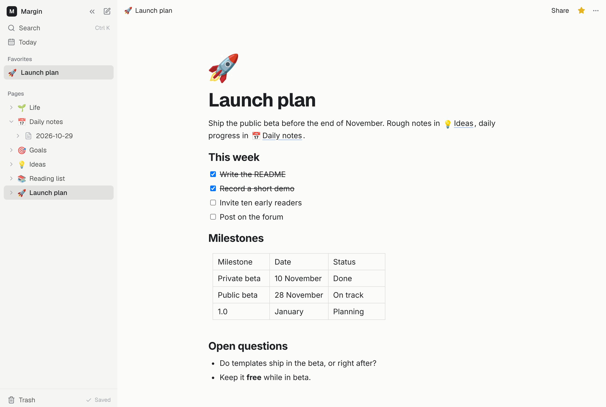

# Margin

<picture>
  <source media="(prefers-color-scheme: dark)" srcset="docs/screenshot-dark.png">
  
</picture>

A quiet notes app that works offline. Nested pages, linked notes, a block editor, sharing and
version history. Use it without an account and nothing leaves your browser; sign in to sync
across devices. AI apps such as Claude and ChatGPT can search, read and write your notes through
its MCP server.

Live at [margin.dhanpulse.in](https://margin.dhanpulse.in). Built with React, TypeScript,
[BlockNote](https://www.blocknotejs.org) and [Supabase](https://supabase.com).

## Features

- **Pages**: nested pages, favorites, trash, `[[` links with backlinks, daily notes, search
- **Editor**: blocks, to-dos, tables, code, images and PDFs (10 MB each, 100 MB per account)
- **Offline first**: everything is saved on the device first and syncs in the background, live
  across devices. Without an account nothing leaves the browser. Sync can be turned off per
  device; then only shared pages sync
- **Sharing**: invite people by email as Full access, Can edit or Can view, or open a page to
  anyone with the link. People take turns editing, and everyone else sees who is
- **Version history**: what changed in each version, highlighted, and restore
- **Presence**: faces show who has a shared page open; the owner also sees who viewed it
- **Import and export**: Markdown in (an Obsidian vault as a .zip) and out, a page as PDF
- **AI agents**: an [MCP](https://modelcontextprotocol.io) server at `/mcp` with OAuth sign-in,
  eight tools and per-account limits ([how to connect](https://margin.dhanpulse.in/agents))
- **Accounts**: email or Google sign-in; delete your account and everything in it

## Quick start

```bash
npm install
cp .env.example .env   # then fill in your Supabase project's URL and publishable key
npm run dev
```

The app needs a Supabase project set up with `supabase/schema.sql`.
[docs/self-hosting.md](docs/self-hosting.md) walks through it, and deploying on Vercel.

## Tests

```bash
npm test             # everything
npm run test:mcp     # the MCP server, with an in-memory database
npm run test:e2e     # the app in Chromium, against a fake Supabase (no project needed)
```

The browser tests need Playwright's Chromium once: `npx playwright install chromium`.

## Layout

```
src/         the app: React, zustand stores, BlockNote editor
  store/     pages (offline storage and sync), sign-in, sharing
  lib/       Markdown, sharing and presence calls, version diffs, media, search helpers
  pages/     screens: home, page, shared page, settings, sign-in, landing, AI agents guide
api/         Vercel functions: the MCP server and a health check
supabase/    schema.sql (the whole database), edge functions, auth email templates
tests/       browser suites with a mock Supabase, and the MCP server test
docs/        self-hosting and architecture
```

[docs/architecture.md](docs/architecture.md) explains sync, sharing, version history and the MCP
server.

## Keyboard shortcuts

| Shortcut | Action |
| --- | --- |
| `Ctrl/⌘ K` | Search |
| `Ctrl/⌘ \` | Toggle sidebar |
| `Alt N` | New page |
| `/` | Insert a block |
| `[[` | Link to a page |

## Contributing and security

See [CONTRIBUTING.md](CONTRIBUTING.md). Please report security problems privately, as
[SECURITY.md](SECURITY.md) describes.

## License

[AGPL-3.0](LICENSE). You can use, change and host Margin. If you let others use a changed version
over a network, share your changes under the same license.
